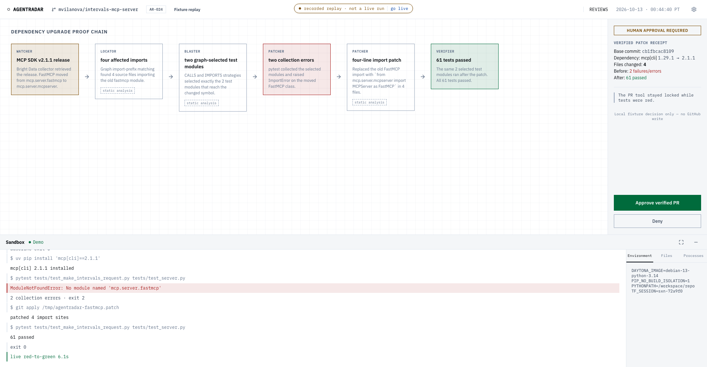
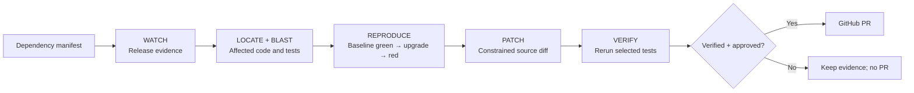

# AgentRadar

**Does this dependency release break your code? Reproduce it, attempt a repair, and review the evidence.**

AgentRadar is a hackathon-winning dependency-break detection and repair project built by [Priyanshu Solanki](https://github.com/priyanshu-liveflow) and [Bsahoo99](https://github.com/Bsahoo99). It combines release discovery, a code graph, and sandbox execution to connect an upstream change to the code and tests it affects.

The graph narrows the investigation. The sandbox runs the experiment. A proposed fix must turn the failing tests green before the PR action is eligible for human approval.



## The workflow



- **Discover:** derive dependencies from the repository manifest and retrieve release/migration evidence through Bright Data.
- **Locate:** use FalkorDB code-graph queries to identify affected source and select tests through both call relationships and transitive imports.
- **Reproduce and repair:** use TrueForge's native Daytona sandbox to establish a passing baseline, upgrade the dependency, observe failure, apply a patch, and rerun the same tests.
- **Verify and act:** validate patch scope, reject test edits, store before/after evidence, and require human approval for GitHub writes.
- **Inspect:** the Next.js mission dashboard displays the graph-to-test evidence chain and sandbox output. Its default mode is explicitly labeled replay.

### The hackathon case

The recorded case upgrades the pinned [`intervals-mcp-server`](https://github.com/mvilanova/intervals-mcp-server) checkout from MCP SDK 1.29.1 to 2.1.1. Four source imports are affected. Import traversal selects two test modules; the upgrade produces two collection errors. A four-line import migration restores a passing run.

The repository records a 61-pass baseline and post-patch result. These are historical demo observations, not a promise about another checkout or today's dependency resolution. See the [demo evidence](docs/demo-repo.md) and [pinned configuration](configs/demo.yaml).

## Try it

### 1. Explore mission control — no service credentials

Requires Node.js 22.14+ and npm. From a fresh clone:

```bash
git clone https://github.com/priyanshu-liveflow/completion_rca.git
cd completion_rca
npm ci --prefix apps/web
npm run dev --prefix apps/web -- --hostname 127.0.0.1
```

Open [localhost:3000](http://localhost:3000). The recorded mission progresses from red to green. Approval in this mode changes local UI state only: **it does not execute tests or write to GitHub**.

### 2. Run a real local repair — no model or cloud account

Requires Python 3.11+, Git, and [uv](https://docs.astral.sh/uv/). From the repository root:

```bash
uv sync --group dev
uv run python scripts/demo_repair.py --canned
```

This builds a temporary billing package with a real defect, runs pytest, applies a fixed patch with Git, reruns pytest, and persists the result. Open [localhost:3000/reviews](http://localhost:3000/reviews) to inspect the evidence and diff. Add `--no-save` for a disposable run.

This checks the repair mechanism. It uses a manually selected test and a fixed patch; it does **not** exercise release discovery, the live graph, a model, or Daytona. The full Python environment includes the inherited Graph RCA dependencies and can take longer to install than the frontend.

### 3. Run the connected dependency workflow

Follow the [live setup runbook](docs/runbook.md) for FalkorDB, Bright Data, TrueForge, model access, Daytona, and GitHub authentication. Then open [localhost:3000/?live=1](http://localhost:3000/?live=1).

The live dashboard streams evidence. **Resolve live approval in TrueForge**: browser approval submission and live-session resume are not implemented in this build. A refresh starts a new dashboard session. The complete dependency-to-PR workflow was demonstrated through the connected harness.

## Architecture and design decisions

| Component | Responsibility |
| --- | --- |
| `src/main/graph_rca`, `code_tools` | Inherited indexing, code queries, and log-based root-cause analysis |
| `src/main/agentradar/contracts` | Pydantic evidence and state contracts |
| `src/main/agentradar/core` | Test selection, verdicts, patch validation, and action policy |
| `src/main/agentradar/adapters` | Graph, Bright Data, sandbox, SQLite, model, and GitHub integrations |
| `src/main/agentradar/mcp` | Tool endpoints for the conductor |
| `agents` | TrueForge manifest, procedures, and idempotent seeding |
| `apps/web` | Mission control, replay/live adapters, and review evidence |

Read the [architecture and tradeoffs](docs/architecture.md). The [review-verification extension](docs/architecture.md#review-verification-extension) reuses the graph and repair pipeline to investigate reviewer findings; dependency repair remains the primary product.

## Limits

- Passing selected tests is evidence about those tests, not proof that the entire application is safe. Missing tests, flaky tests, dynamic imports, and incomplete graph edges limit coverage.
- Index and execution must refer to the same source revision. Stale graphs can select the wrong code or tests.
- The demonstrated dependency migration is a small Python import change. Broad migrations, other ecosystems, and production workloads need further evaluation.
- Collectors, model availability, sandbox quotas, and network access are external dependencies. Replay is a presentation fallback, not fresh verification.
- This is a local development/demo application, without a public-hosting authentication boundary. Keep the dashboard and MCP servers local; cloud deployment needs additional work.
- The approval gate checks stored evidence and patch constraints. It is not a formal proof or a substitute for human review.

## Development and tests

See [testing](docs/testing.md) for backend checks, frontend tests, browser E2E, and the boundary between local checks and live-service validation.

```bash
uv run pytest tests/agentradar tests/shared -q
npm run lint --prefix apps/web
npm run test --prefix apps/web
npm run build --prefix apps/web
```

[Contributing](CONTRIBUTING.md) · [Live runbook](docs/runbook.md) · [Graph RCA CLI](docs/graph-rca.md) · [Documentation index](docs/README.md)

## Credits and license

Built together by **Priyanshu Solanki** and **Bsahoo99**, with the original Graph RCA stack retained as the code-intelligence foundation. Git history preserves the project contributions.

Project code is available under the [MIT license](LICENSE). External dependencies and demo repositories retain their own licenses; the external demo source is not included in this repository.
