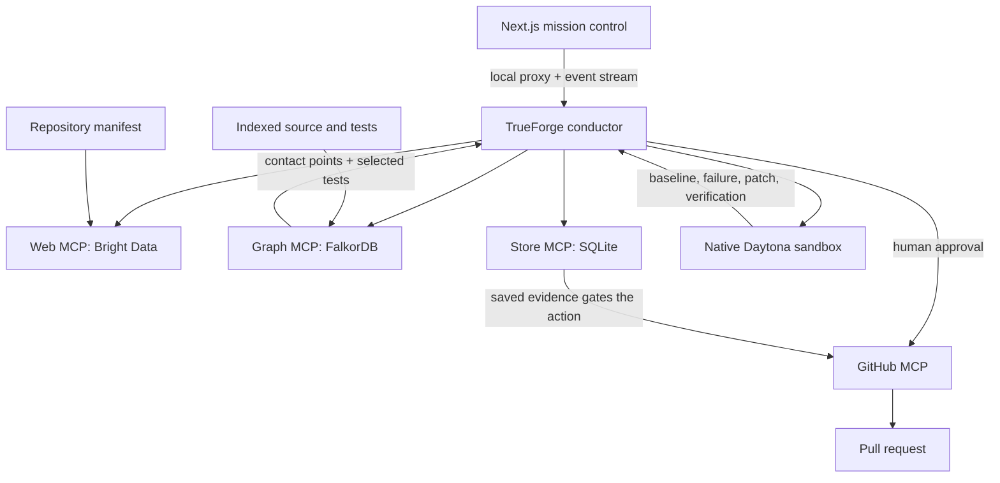

# Architecture

AgentRadar investigates whether a dependency release breaks a particular repository and attempts a test-backed repair. It is built on Graph RCA, whose original log-analysis CLI remains available.

## Connected workflow

The conductor is configured by `agents/conductor.json`. `agents/seed.ts` combines the procedure files with the action policy and registers the agent and MCP servers. The checked-in model selection is configuration, not an architectural requirement; it must match a provider registered in the running harness.

The browser's live adapter translates streamed TrueForge events and mission snapshots into the dashboard reducer. It does not run the dependency experiment itself. The server proxies harness calls so provider credentials do not need to enter browser code.

## Why the graph comes before execution

The graph locates source contact points and narrows the tests worth running. `core/selection.py` unions two paths:

1. **CALLS:** walk callers toward test functions. Useful when changed behavior is invoked by tests.
2. **IMPORTS:** join module names back to files and follow transitive importers, respecting dotted-name boundaries. This catches import-time failures that a function-call walk cannot see.

In the recorded demo, caller traversal alone found no tests for the moved import; import traversal selected the two affected test modules. That observation motivated shipping both strategies. It is not a general completeness guarantee.

## Verification and action boundaries

A dependency experiment should establish a passing baseline at the indexed commit, upgrade the dependency, and reproduce a failure before proposing a repair. The same selected tests are then rerun after patching.

The Python gate derives `verified` from `before.is_broken` and `after.is_green`. Collection errors and nonzero process exits matter; `failed == 0` alone does not imply success. Patch validation reparses the diff, rejects test changes, and restricts changes to graph-derived allowed files. The GitHub tool loads evidence from the mission store, and the harness applies the configured human-approval requirement.

These checks constrain agent behavior. They do not establish complete application correctness, independently attest every agent-supplied report, or guarantee that a test failure uniquely proves a particular root cause. Human review and adequate tests still matter.

## Module boundaries

- **Contracts:** Pydantic data models, with exported JSON schemas for consumers.
- **Core:** decisions over contracts and narrow protocols. No direct network, filesystem, or subprocess implementation.
- **Adapters:** external effects and concrete implementations.
- **MCP:** parse arguments, invoke the core/adapters, and return structured tool results.

`scripts/check_layering.py` checks the dependency direction. SQLite retains mission and review evidence so a result can be inspected after the agent turn ends.

## Dashboard modes

| Mode | What runs | What an approval does |
| --- | --- | --- |
| Default `/` | Timed fixture events | Updates local UI state; no GitHub write |
| `/?live=1` | TrueForge session and real service tools | Complete approval in the harness; browser submission is unavailable |
| `/reviews`, fixed-patch demo | Real local pytest and Git against a temporary billing package | Shows eligibility, without opening a demo PR |

The replay patch is illustrative; its hunk positions are not an apply-ready artifact for the external repository. Live evidence belongs to the actual run. The sandbox pop-out is a read-only view of dashboard state, not a shell.

The live dashboard currently starts a new session when mounted. It does not reconnect to an existing mission after refresh. A recorded replay is explicitly labeled and cannot substitute for live-service verification.

## Review-verification extension

`core/review_run.py` takes a reviewer finding, locates the source, selects tests, and classifies the result as confirmed, unreproduced, uncovered, inconclusive, or unlocatable. Passing tests do not dismiss an untested claim as false. Only confirmed findings enter the repair path. Local execution is intended for trusted checkouts; dependency-upgrade experiments belong in the remote sandbox.

## Scope and limitations

The project demonstrates one complete Python dependency migration with a narrow import patch. It does not yet provide broad migration coverage, production deployment hardening, exhaustive regression selection, or scheduled monitoring guarantees. Dynamic behavior and stale/incomplete indexes can escape graph selection. External service quotas and availability remain operational dependencies.

Historical plans and measurements are retained for context; see the [documentation index](README.md).
